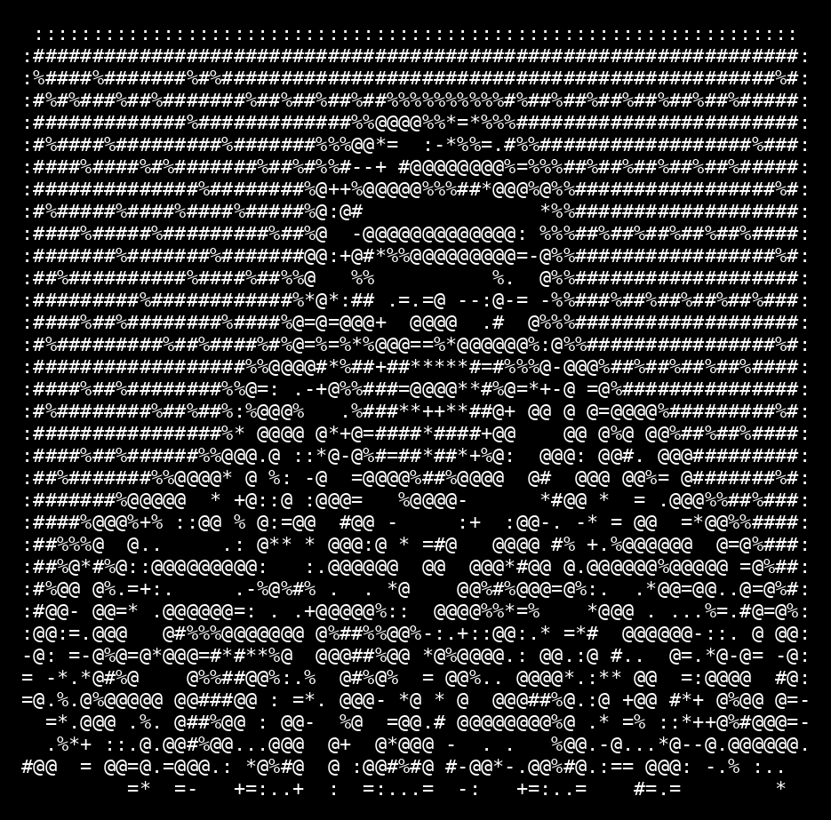

<p align="center">
  
</p>

<p align="center">
  
</p>

<p align="center">
  <a href="https://linkedin.com/in/adryantaborda"></a>
  <a href="https://adryantaborda.com/en/"></a>
  <a href="mailto:contact@adryantaborda.com"></a>
</p>

<br/>

<table>
<tr>
<td width="46%" valign="middle">
  
</td>
<td width="54%" valign="middle">

```text
adryan@taborda:~$ whoami
Adryan Taborda

role        Full Stack Software
            Engineer | AI Agents

focus       Async Python + Go
            microservices, RAG,
            distributed systems

core        Clean Architecture
            multi-tenancy
            high-concurrency APIs

agents      deterministic
            orchestration, LLM
            tool-calling workflows

specialty   System Design
            Python Internals
            Async Patterns
            Autonomous Agents

adryan@taborda:~$ _
```

</td>
</tr>
</table>

<br/>

### `// PRODUCTION REPOSITORIES`

Most of my production-ready **FastAPI microservices**, **LLM/RAG pipelines** and **multi-tenant SaaS architectures** live under my organization.

<p align="center">
  <a href="https://github.com/orgs/Adryan-Taborda-Portfolio/repositories">
    
  </a>
</p>

<br/>

### `// SYSTEM ARCHITECTURE`

```text
stack/
├── backend/     Python · Go · FastAPI · Django · Node.js · PostgreSQL · Redis
├── ai/          LangChain · LlamaIndex · Claude API · OpenAI API · Vector DBs
├── frontend/    TypeScript · Vue.js · TailwindCSS
└── infra/       Vercel · AWS · Docker · GitHub Actions
```

<table>
  <tr>
    <td><code>BACKEND</code></td>
    <td>
      
      
      
      
      
      
      
    </td>
  </tr>
  <tr>
    <td><code>AI</code></td>
    <td>
      
      
      
      
      
    </td>
  </tr>
  <tr>
    <td><code>FRONTEND</code></td>
    <td>
      
      
      
    </td>
  </tr>
  <tr>
    <td><code>INFRA</code></td>
    <td>
      
      
      
      
    </td>
  </tr>
</table>

<br/>

```text
"Architecture is not about complexity -
 it's about orchestrating clarity, performance, and trust in code."
```

<p align="center">
  
</p>
